# Stufenweise – Anleitung mit Bildern

Diese Anleitung zeigt in sieben Schritten, wie du Stufenweise auf dem iPad einsetzt: von der PIN bis zur Rückmeldung. Die Bilder zeigen die App im Querformat, das ausgedachte Kind heißt „Testkind A“. **Orange umrandet** ist jeweils der Knopf, auf den es ankommt.

## Die Knöpfe oben

Oben rechts liegen sieben Knöpfe. Auf dem iPad stehen keine Wörter darunter, deshalb hier mit Nummern:

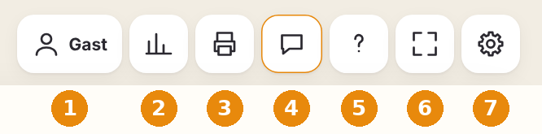

1. **Kind wählen** (zeigt den Namen, am Anfang „Gast“): Kinder anlegen und Tests starten.
2. **Lernstand:** Kompetenzmatrix, Förderzone und ILEB-Formulierungen. Nur für die Lehrkraft.
3. **Arbeitsblätter:** Blätter passend zur Förderzone erstellen und drucken.
4. **Rückmeldung** (orange umrandet): Fehler, Ideen und Lob melden.
5. **Anleitung (?):** Hilfe zu allen Bereichen und „Über Stufenweise“ mit Lizenz und Danke.
6. **Vollbild:** blendet die Leisten des Browsers aus.
7. **Einstellungen:** PIN, eigene Wörter, Hilfen und Datensicherung.

Das Stufen-Zeichen links oben führt immer zur Startseite. Darunter liegen die Übungsbereiche.

## Schritt 1: Lehrkraft-PIN festlegen

Leg die PIN fest, bevor Kinder mit dem iPad arbeiten. Danach sind Lernstand, Tests, Arbeitsblätter und Einstellungen geschützt.

1. Oben auf **Einstellungen** (7) tippen.
2. Nach unten scrollen bis **Lehrkraft-PIN**.
3. Vier Ziffern eingeben und **PIN festlegen** tippen.

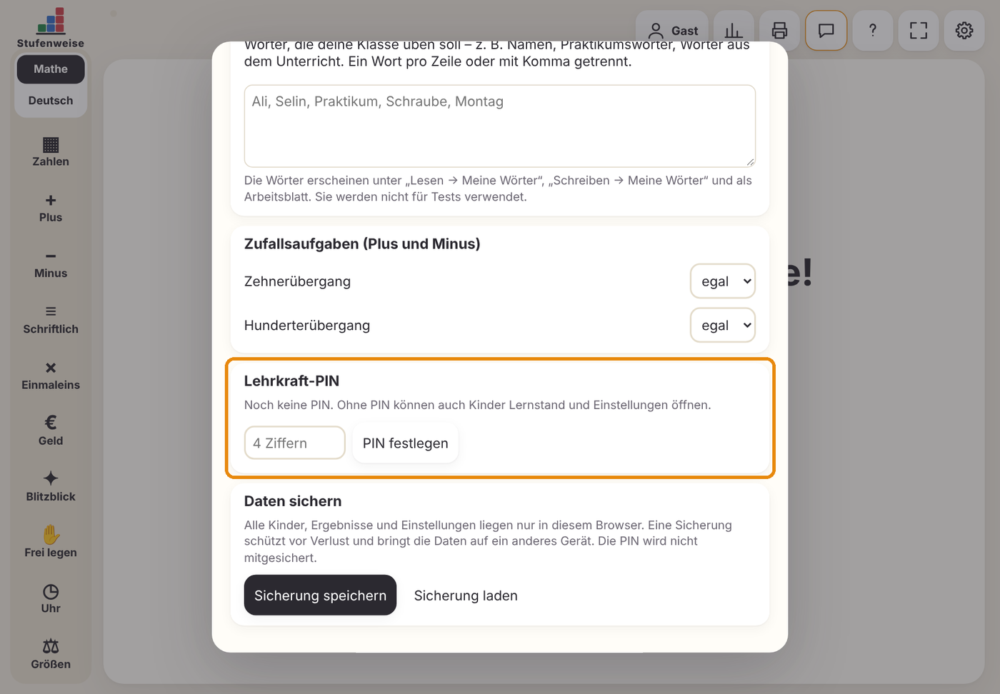

Nach der Eingabe bleibt der Lehrkraft-Bereich 20 Minuten offen. Gleich darunter liegt **Daten sichern**: Damit speicherst du alle Kinder und Ergebnisse als Datei, denn sie liegen nur in diesem Browser.

## Schritt 2: Kind anlegen und Test wählen

Jedes Kind bekommt ein eigenes Profil. Nimm Vornamen oder Kürzel.

1. Oben auf **Kind wählen** (1) tippen. Das Fenster „Wer übt?“ öffnet sich.
2. Den Namen eingeben und **Hinzufügen** tippen.

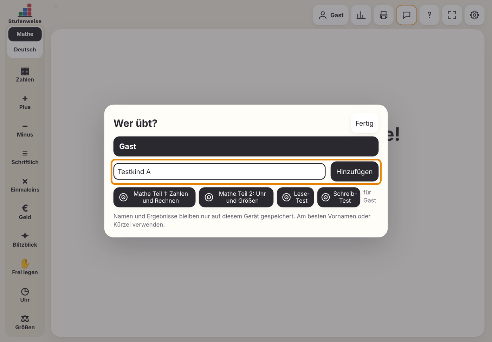

Das neue Kind ist jetzt ausgewählt (dunkel hinterlegt). Darunter stehen die vier Tests:

- **Mathe Teil 1:** Zahlen und Rechnen
- **Mathe Teil 2:** Uhr und Größen
- **Lese-Test**
- **Schreib-Test**

Tipp auf den Test, den das Kind jetzt machen soll. Mach Teil 1 und Teil 2 am besten an verschiedenen Tagen.

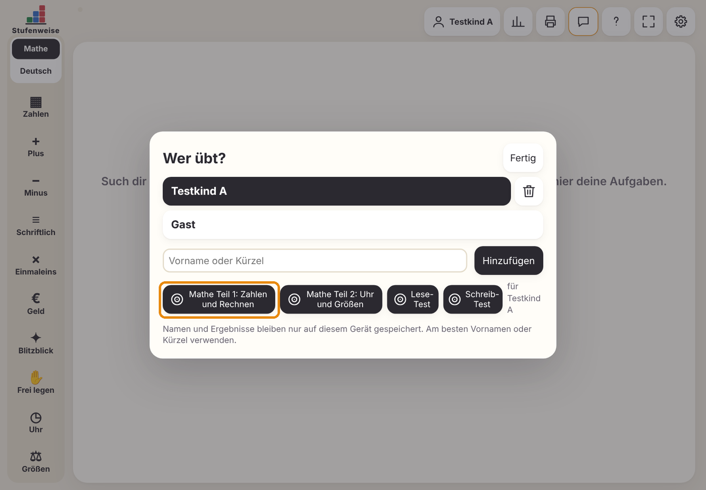

## Schritt 3: Der Test

Der Test passt sich an: Gelöste Aufgaben führen zu schwereren, nicht gelöste zu leichteren. Er dauert etwa 10–20 Minuten.

Zuerst sieht das Kind eine ermutigende Begrüßung. Lies sie bei Bedarf vor und tippe dann auf **Los geht’s**.

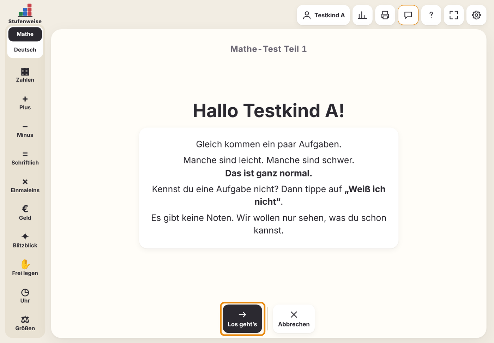

Bei jeder Aufgabe steht oben, was zu tun ist. Zahlen gibt das Kind über die Zifferntastatur ein. Kennt es eine Aufgabe nicht, tippt es auf **Weiß ich nicht**. Das ist ausdrücklich erlaubt und verfälscht nichts.

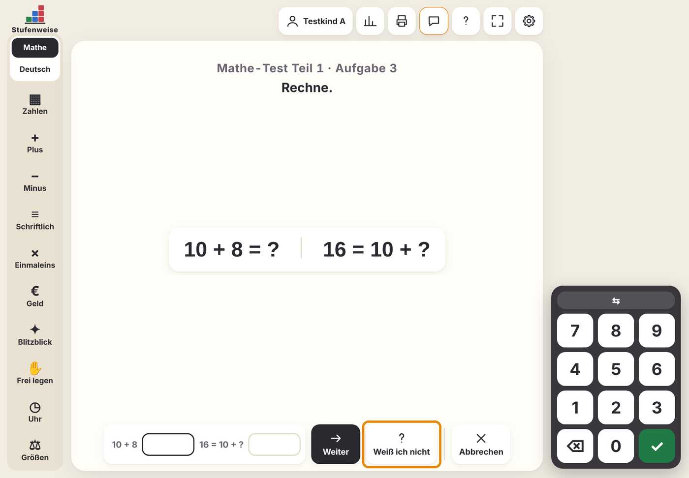

Am Ende sieht das Kind keine Ergebnisse, nur ein Dankeschön. Für dich führt der Knopf **Lernstand (Lehrkraft)** direkt zur Auswertung.

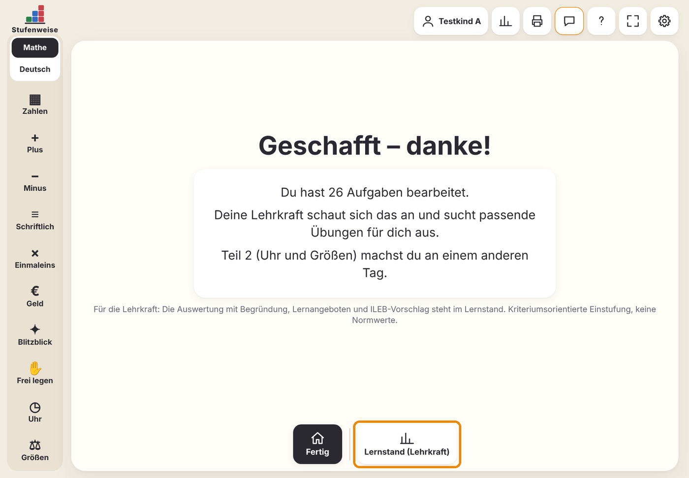

## Schritt 4: Lernstand ansehen

Der Knopf **Lernstand** (2) zeigt drei Dinge, untereinander. Oben wählst du das Kind oder „Ganze Klasse“.

**Die Kompetenzmatrix:** Dunkelgrünes ✓ heißt erreicht, hellgrünes ✓ abgeleitet (aus einer höheren Stufe geschlossen), ½ teilweise, rotes ✗ nicht erreicht, Strich nicht getestet. Antippen ändert eine Einstufung, wenn du das Kind anders erlebst.

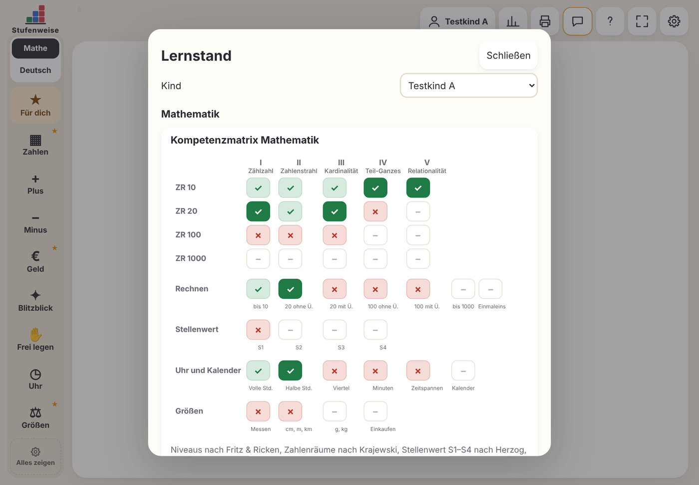

**Die Förderzone:** Darunter steht für jeden Bereich die erste Stufe, die noch nicht sicher ist, mit Begründung und Bezug zum Bildungsplan. **Lernangebot starten** öffnet die passende Übung, **Arbeitsblatt** das passende Blatt. Die Analog-Ideen helfen bei der Förderung ohne Gerät.

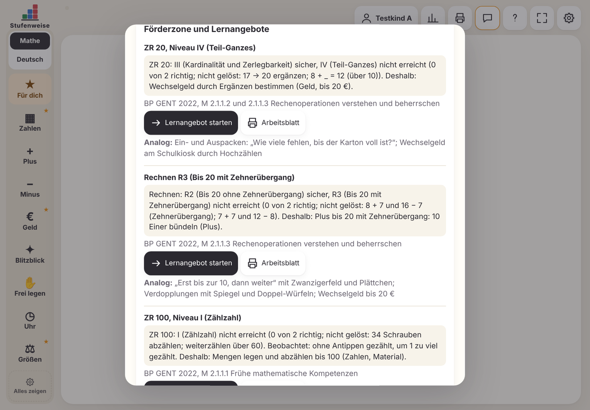

**Der ILEB-Vorschlag:** Ganz unten steht ein Formulierungsvorschlag mit Lernstand, nächstem Ziel und Maßnahmen. **ILEB-Text kopieren** übernimmt ihn in deine Vorlage. Prüf und ergänze ihn immer mit deiner eigenen Beobachtung.

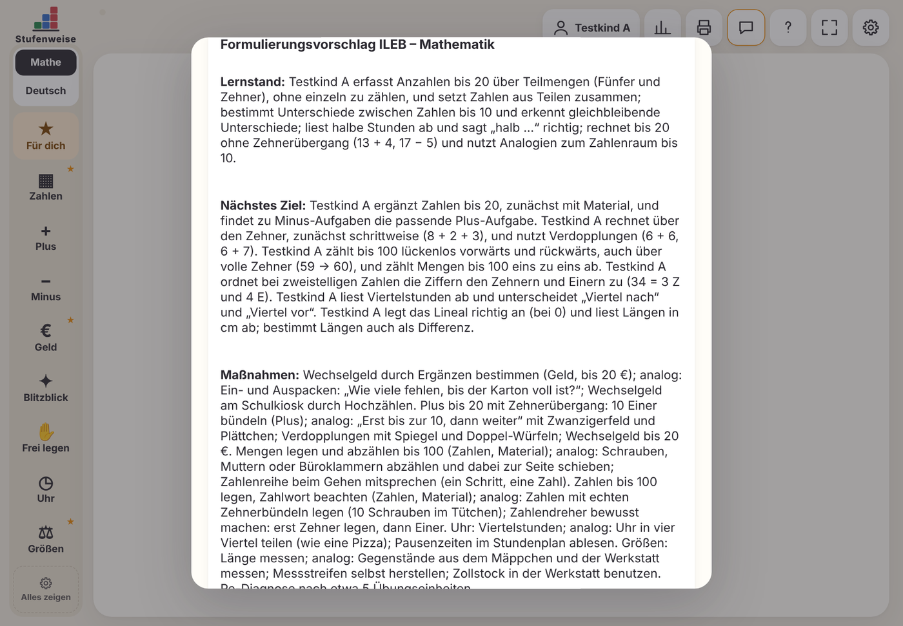

## Schritt 5: Üben

Nach dem Test findet das Kind seine Übungen selbst. Das Stufen-Zeichen links oben führt zur Startseite.

1. Das Kind tippt auf seinen Namen.
2. Unter **Heute für dich** steht die passende Übung aus der Förderzone. Ein Tipp darauf startet sie.
3. Die **Startrunde** (3 Aufgaben) eignet sich zum Aufwärmen, die **Lernlandkarte** zeigt, was das Kind schon kann.

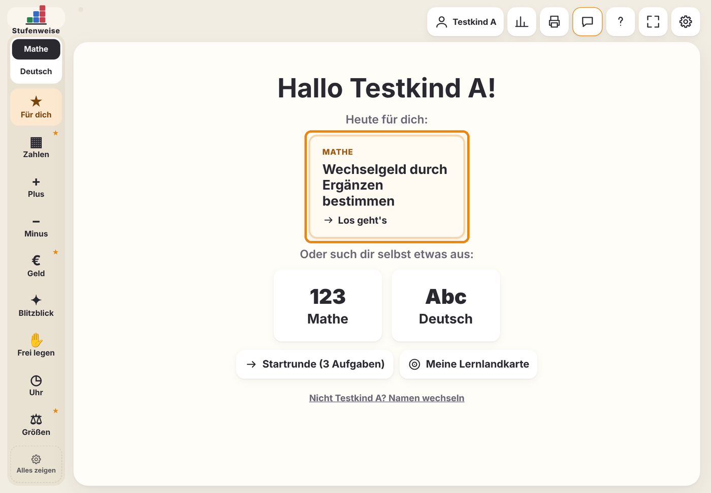

Die Übung stellt sich selbst ein, hier zum Beispiel Wechselgeld bis 20 €. Links sieht das Kind nur die Bereiche, die für es dran sind, mit ★ für die Förderzone. Bei Fehlern gibt es einen konkreten Tipp. Wie viel ein Kind sehen darf, stellst du in den Einstellungen unter „Geführte Oberfläche“ ein.

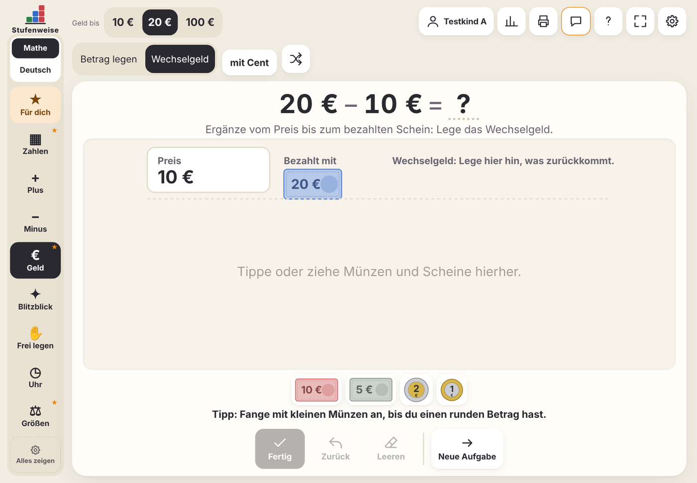

## Schritt 6: Arbeitsblätter drucken

1. Oben auf **Arbeitsblätter** (3) tippen.
2. Das Kind wählen. Unter „Passend zur Förderzone“ stehen seine Stufen, zum Beispiel „Rechnen R3“.
3. Bei Bedarf Thema, Zahlenraum und Material anpassen. Bei „Aufgaben“ füllt „Blatt füllen“ die Seite mit vollen Reihen; du kannst auch eine feste Zahl wählen. Rechts siehst du die Vorschau.
4. **Drucken** tippen. „Lösungsblatt anhängen“ legt eine Seite mit den Lösungen dazu.

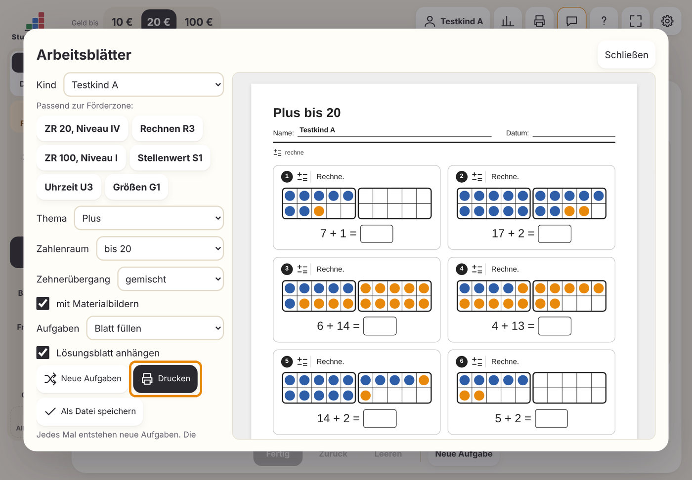

Jedes Mal entstehen neue Aufgaben. Jedes Blatt trägt unten den Hinweis „Stufenweise · © Stefan Hackl · frei nutzbar unter CC BY-SA 4.0“, du darfst es also kopieren und weitergeben.

Alle Materialbilder auf einem Blatt haben dieselbe Größe, Hunderter liegen in Fünferreihen. Neu ist das Thema **Zahlen mit Material zeichnen**: Die Kinder zeichnen Zahlen in der Kurzschreibweise □ Hunderter, | Zehner, • Einer und lesen gezeichnete Zahlen ab. Wählst du eine Förderzone aus dem Rechnen, passt das Blatt genau dazu, zum Beispiel „Plus bis 20, mit Zehnerübergang“ für R3.

## Schritt 7: Rückmeldung geben

Melde dich am besten genau dann, wenn dir etwas auffällt. Die App schickt automatisch mit, wo du gerade bist, aber keinen Kindernamen.

1. Oben auf **Rückmeldung** (4) tippen.
2. Auswählen: **Fehler**, **Passt nicht**, **Idee** oder **Gefällt mir**.
3. Bei Fehlern und „Passt nicht“ angeben, wie schlimm es ist.
4. In eigenen Worten schreiben, was passiert ist und was du erwartet hättest.
5. Absenden, auf einem von zwei Wegen:
    - **Auf GitHub melden:** öffnet eine fertig ausgefüllte Meldung (Issue). Dafür brauchst du ein kostenloses GitHub-Konto. Die Meldung ist öffentlich, also bitte keine Namen von Kindern.
    - **Per E-Mail senden:** öffnet deine Mail-App mit fertigem Text an stufenweise@posteo.de.

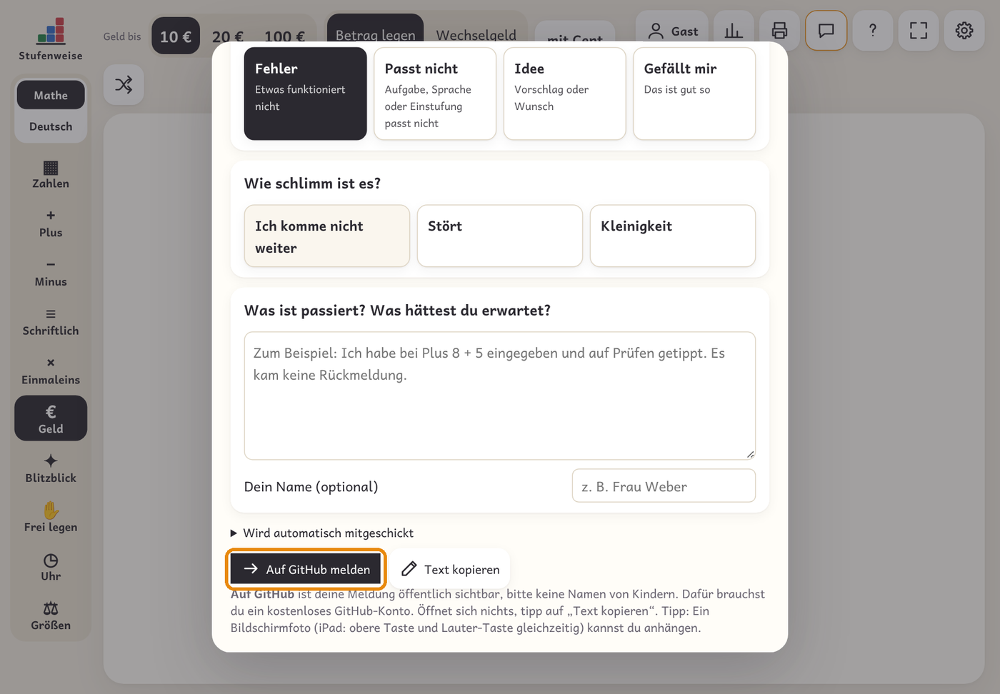

Öffnet sich nichts, tipp auf **Text kopieren** und füge den Text in eine Mail oder eine [neue Meldung auf GitHub](https://github.com/Steffinuss/stufenweise/issues/new) ein. Die Mail-Adresse lässt sich in den Einstellungen ändern oder leeren.

## Über Stufenweise: Lizenz und Danke

Stufenweise ist ein offenes Projekt: kostenlos, ohne Werbung und für alle Schulen. Unter **Anleitung (?)** steht ganz unten „Über Stufenweise“.

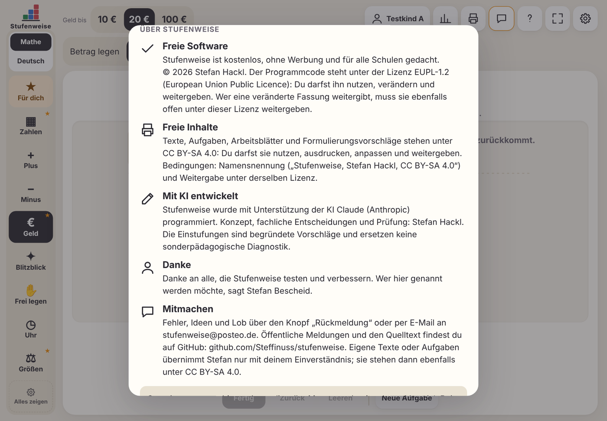

| Was | Lizenz | Das bedeutet |
| --- | --- | --- |
| Programmcode | [EUPL-1.2](../LICENSE) | Nutzen, verändern und weitergeben erlaubt. Wer eine veränderte Fassung weitergibt, muss sie ebenfalls offen unter EUPL-1.2 weitergeben. |
| Texte, Aufgaben, Arbeitsblätter, diese Anleitung | [CC BY-SA 4.0](../LIZENZ-INHALTE.md) | Nutzen, ausdrucken, anpassen und weitergeben erlaubt, mit Namensnennung „Stufenweise, Stefan Hackl, CC BY-SA 4.0“ und unter derselben Lizenz. |

Stufenweise wurde mit Unterstützung der KI Claude (Anthropic) programmiert. Konzept, fachliche Entscheidungen und Prüfung liegen bei Stefan Hackl.

---

Diese Anleitung steht unter [CC BY-SA 4.0](https://creativecommons.org/licenses/by-sa/4.0/deed.de) · Stufenweise, Stefan Hackl
