# Stufenweise – Anleitung mit Bildern

Diese Anleitung zeigt in sieben Schritten, wie du Stufenweise auf dem iPad einsetzt: von der PIN bis zur Rückmeldung. Die Bilder zeigen die App im Querformat, das ausgedachte Kind heißt „Testkind A“. **Orange umrandet** ist jeweils der Knopf, auf den es ankommt.

## Die Knöpfe oben

Oben rechts liegen zwei Knöpfe: der **Name** des Kindes (am Anfang „Gast“) und das Menü **⋯**. So bleibt für die Aufgabe mehr Platz.

1. **Name / Kind wählen:** Kinder anlegen, Themenwelt und Bildmodus einstellen und Tests starten.
2. **Menü ⋯** mit:
   - **Lernstand:** Kompetenzmatrix, Förderzone und ILEB-Formulierungen. Nur für die Lehrkraft.
   - **Arbeitsblätter:** Blätter passend zur Förderzone erstellen und drucken.
   - **Rückmeldung geben:** Fehler, Ideen und Lob melden.
   - **Anleitung:** Hilfe zu allen Bereichen und „Über Stufenweise“ mit Lizenz und Danke.
   - **Vollbild:** blendet die Leisten des Browsers aus.
   - **Einstellungen:** in vier Registerkarten: **Allgemein** (Start, Bedienung, Ergebnisse), **Mathe** (Material, Zehnerübergang, Uhr), **Deutsch** (Tastatur, eigene Wörter) und **Kinder & Daten** (geführte Oberfläche, PIN, Datensicherung, Geräteumzug).

Das Stufen-Zeichen links oben führt immer zur Startseite. Darunter liegen die Übungsbereiche.

## Schritt 1: Lehrkraft-PIN festlegen

Leg die PIN fest, bevor Kinder mit dem iPad arbeiten. Danach sind Lernstand, Tests, Arbeitsblätter und Einstellungen geschützt.

1. Oben auf **Einstellungen** (7) tippen und die Registerkarte **Kinder & Daten** wählen.
2. Unter **Lehrkraft-PIN** vier Ziffern eingeben und **PIN festlegen** tippen.

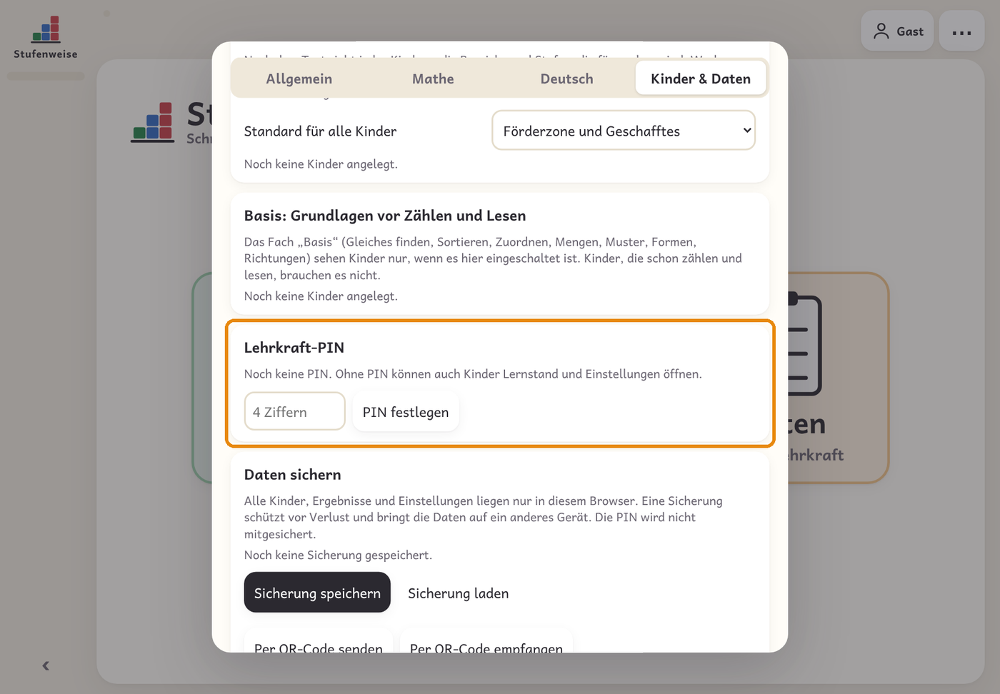

Nach der Eingabe bleibt der Lehrkraft-Bereich 20 Minuten offen. Gleich darunter liegt **Daten sichern**: Damit speicherst du alle Kinder und Ergebnisse als Datei, denn sie liegen nur in diesem Browser.

## Schritt 2: Kind anlegen und Test wählen

Jedes Kind bekommt ein eigenes Profil. Nimm Vornamen oder Kürzel.

1. Oben auf **Kind wählen** (1) tippen. Das Fenster „Wer übt?“ öffnet sich.
2. Den Namen eingeben und **Hinzufügen** tippen.

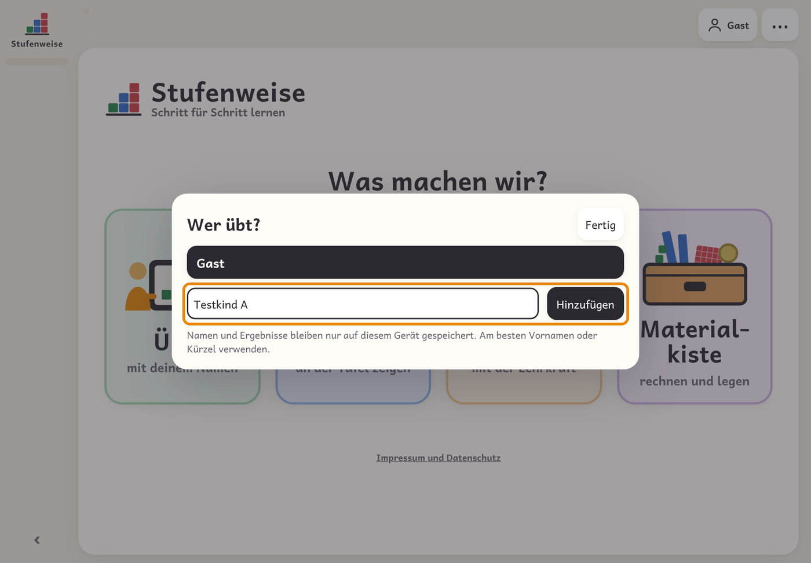

Das neue Kind ist jetzt ausgewählt (dunkel hinterlegt).

**Test starten:** Auf der Startseite gibt es neben „Üben“ und „Unterricht“ die Kachel **Testen** (mit Lehrkraft-PIN, falls eine eingestellt ist). Dann wählst du das Kind und danach den Test. Die Tests stehen nach Fach geordnet, jeweils mit dem Stand („noch nicht gemacht“ oder „gemacht · zuletzt am …“):

- **Basis** Teil 1 bis 3, nur wenn bei dem Kind „Basis“ angehakt ist, es schon Basis-Ergebnisse hat oder Mathe „Zahlen bis 10, Stufe I“ bzw. Lesen L1 nicht erreicht ist (dann mit Hinweis „Vorgeschlagen“)
- **Mathe** Teil 1: Zahlen und Rechnen, Teil 2: Uhr, Größen, Hundertertafel
- **Deutsch:** Lese-Test, Schreib-Test
- **Wiederholung:** testet nur die offenen Stufen eines Tests noch einmal; „empfohlen“, wenn seit dem letzten Test viel geübt wurde

Tipp auf den Test, den das Kind jetzt machen soll. Mach die Teile am besten an verschiedenen Tagen. Nach dem Test kommst du wieder zur Testauswahl; mit „Anderes Kind“ geht es mit dem nächsten Kind weiter. Im Lernstand eines Kindes kannst du Tests ebenfalls starten, direkt beim jeweiligen Fach.

### Themenwelt, Erkennungsbild und „ohne Lesen“

Neben jedem Namen stehen (mit Lehrkraft-PIN) diese Einstellungen (dazu das Häkchen **Basis**, siehe „Basis: Grundlagen vor dem Zählen“):

- **Themenwelt GS, HS oder BSS:** Stufen, Tests und Kompetenzmatrix bleiben gleich. Es ändern sich nur die Inhalte: Lesetexte, Pläne, Sachaufgaben und Einkaufszettel. In der Grundstufe geht es zum Beispiel um Pause, Tiere, Geburtstag und Stundenplan, in der Hauptstufe um Freizeit, Einkaufen und Kino, in der Berufsschulstufe zusätzlich um Praktikum, Arbeit und Wohnen. Die Ergebnisse bleiben dadurch vergleichbar. Auch Arbeitsblätter für ein Kind nehmen seine Themenwelt. Für Gast und Unterricht stellst du die Themenwelt in den Einstellungen (Hilfen) ein, im Unterricht auch direkt auf der Startseite.
- **Erkennungsbild:** Tipp auf das Bildfeld und wähl eines der Bilder (Fisch, Ball, Sonne …). Es erscheint auf der Startseite statt des Anfangsbuchstabens. So finden auch Kinder, die ihren Namen noch nicht lesen, ihr Feld.
- **ohne Lesen (Bildmodus):** für Kinder, die (noch) nicht lesen. Über jeder Übung steht ein Bild, das zeigt, was zu tun ist (antippen, auswählen, legen, eintippen, Uhr stellen). Der Satz steht nur noch klein darunter, für Erwachsene. Rückmeldungen kommen als großes Zeichen: grüner Haken für richtig, orangefarbener Pfeil für „noch einmal“. Knöpfe zeigen nur ihre Symbole, und der Rückblick nach einer Runde hat drei Bildknöpfe (Treppe = schwerer, Kreispfeil = noch eine Runde, Haus = Pause). Im Test bleibt der Text normal groß, weil dort die Lehrkraft mitliest.

## Schritt 3: Der Test

Der Test passt sich an: Gelöste Aufgaben führen zu schwereren, nicht gelöste zu leichteren. Er dauert etwa 10–20 Minuten.

Oben zeigt eine Leiste, wie weit das Kind ist: die Abschnitte des Tests (z. B. *Zahlen · Rechnen · Stellenwert*) und darunter einen Balken. Der Balken läuft nur vorwärts, auch wenn der Test eine leichtere Stufe einschiebt. Er zeigt nie, ob eine Antwort richtig oder falsch war. Weil sich der Test anpasst, ist die Länge nur ungefähr: Ein Abschnitt kann früher enden, und am Ende springt der Balken auf fertig. Beim Lese- und Schreib-Test gibt es nur den Balken.

Während des Tests sind die Leiste links und das Menü oben gesperrt. So kann niemand versehentlich hinaustippen. Zum Beenden tippst du zweimal auf **Abbrechen** (beim ersten Mal steht dort „Wirklich beenden?“). Was bis dahin getestet wurde, bleibt gespeichert.

Jede Aufgabe passt auf den Bildschirm, auch auf kleinere iPads mit Safari-Leisten: Ist wenig Platz, wird die Aufgabe etwas kleiner. Nur sehr lange Lesetexte muss man schieben; dann steht unten „Weiter unten“.

Zuerst sieht das Kind eine ermutigende Begrüßung. Lies sie bei Bedarf vor und tippe dann auf **Los geht’s**.

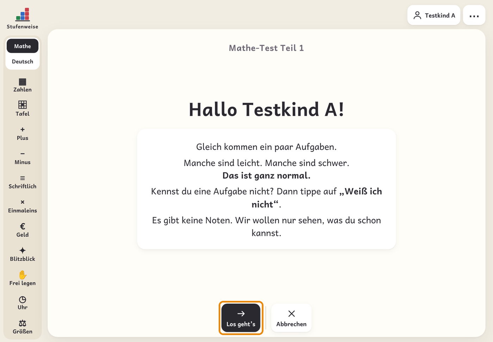

Bei jeder Aufgabe steht oben, was zu tun ist. Zahlen gibt das Kind über die Zifferntastatur ein. Kennt es eine Aufgabe nicht, tippt es auf **Weiß ich nicht**. Das ist ausdrücklich erlaubt und verfälscht nichts. Die Zifferntastatur bleibt stehen, solange es auf dem Bildschirm ein Zahlenfeld gibt, auch wenn das Kind zwischendurch etwas antippt (z. B. die Schrauben beim Zählen). So verrutscht nichts. Sie schwebt über der Aufgabe: Am Griff **⠿** lässt sie sich an jede Stelle ziehen, mit **▾** rollt man sie zu einem kleinen Knopf „123“ ein.

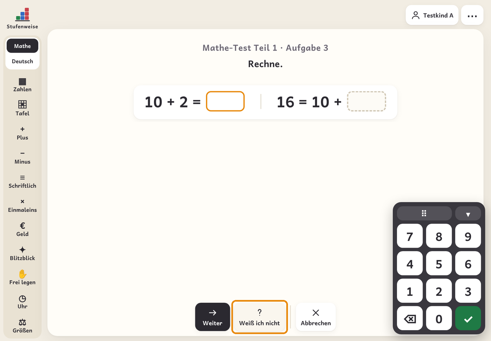

Am Ende sieht das Kind keine Ergebnisse, nur ein Dankeschön. Für dich führt der Knopf **Lernstand (Lehrkraft)** direkt zur Auswertung.

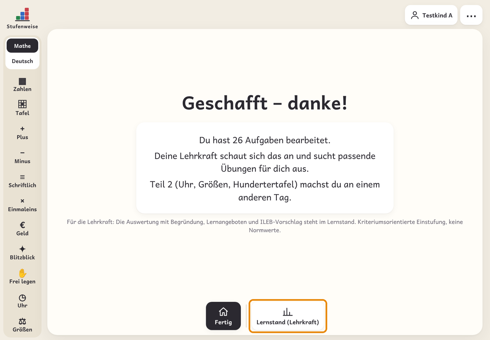

## Schritt 4: Lernstand ansehen

Der Knopf **Lernstand** (2) zeigt drei Dinge, untereinander. Oben wählst du das Kind oder „Ganze Klasse“.

**Die Kompetenzmatrix:** Dunkelgrünes ✓ heißt erreicht, hellgrünes ✓ abgeleitet (aus einer höheren Stufe geschlossen), ½ teilweise, rotes ✗ nicht erreicht, Strich nicht getestet. Antippen ändert eine Einstufung, wenn du das Kind anders erlebst.

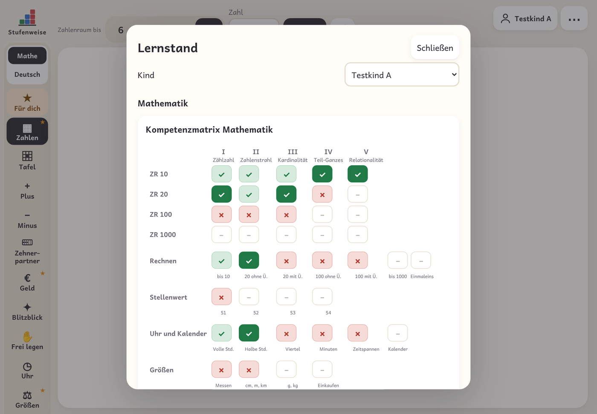

**Die Förderzone:** Darunter steht für jeden Bereich die erste Stufe, die noch nicht sicher ist, mit Begründung und Bezug zum Bildungsplan. **Lernangebot starten** öffnet die passende Übung, **Arbeitsblatt** das passende Blatt.

**Am Material:** Zu jeder Förderzone steht ein Weg in drei Schritten: erst **Handeln** mit echtem Material, dann **im Bild** auf einem Legeblatt, dann **Zahl und Schrift** in Stufenweise und im Heft. Dazu kommen eine Materialliste und der Knopf **Legeblatt drucken**. „Im Alltag“ nennt weitere Ideen ohne Gerät. Alle Wege stehen gesammelt in der Übersicht [Lernort Material](material.md).

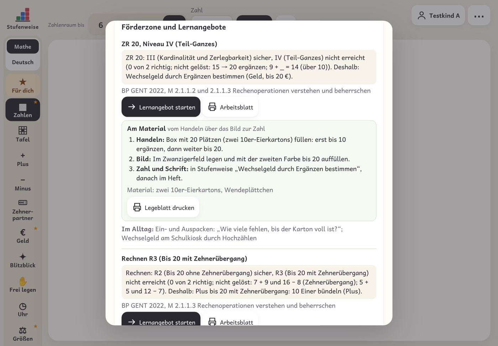

**Der ILEB-Vorschlag:** Ganz unten steht ein Formulierungsvorschlag mit Lernstand, nächstem Ziel und Maßnahmen. **ILEB-Text kopieren** übernimmt ihn in deine Vorlage. Prüf und ergänze ihn immer mit deiner eigenen Beobachtung.

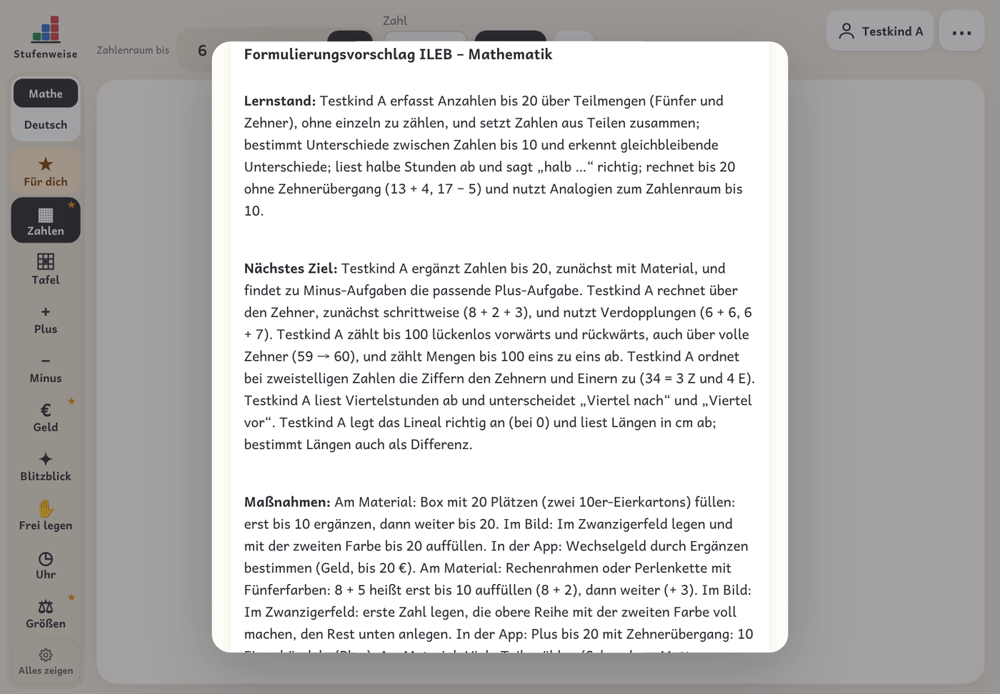

**Übungsprotokoll:** Darunter stehen die geübten Bereiche, **typische Fehler** und **übersprungene Aufgaben**. Kommt ein Fehler öfter vor (ab 3-mal), steht unter „Nächster Schritt am Material“, wie das Kind die Aufgabe mit Material nachlegen kann, zum Beispiel beim Zehnerübergang: 10 Einer sichtbar gegen eine Zehnerstange tauschen. Typische Fehler erkennt die App beim Rechnen selbst: um 1 verzählt, Zahlendreher, Zehner falsch, falsche Rechenart (plus statt minus), Zehnerübergang nicht beachtet und „klein von groß“ bei Minus (bei 32 − 5 wird 5 − 2 gerechnet). Das Kind bekommt dazu sofort einen passenden Tipp. Übersprungen heißt: Das Kind hat zur nächsten Aufgabe geklickt, ohne die Aufgabe zu lösen. Du siehst, wie oft, in welchem Bereich und bei welchen Aufgaben.

**Wochenübersicht:** Unter **Bericht drucken** gibt es neben Lernstandsbericht, Elterninfo und Lernlandkarte die **Wochenübersicht** für die letzten 7 Tage: Aufgaben pro Tag als Balken, geübte Bereiche mit Anzahl, Anteil gleich richtig, geschätzter Übungszeit, übersprungenen Aufgaben und Stufen, dazu „Läuft sicher“, „Braucht noch Unterstützung“ und Platz für Notizen. Am Ende steht der nächste Schritt am Material für jede Förderzone. Gut für das ILEB- oder Elterngespräch.

## Schritt 5: Üben

Nach dem Test findet das Kind seine Übungen selbst. Das Stufen-Zeichen links oben führt zur Startseite.

Die Startseite führt in drei Stufen zur Übung. Oben rechts zeigt eine Treppe, wo das Kind gerade ist. Jede Stufe zeigt mit Bild und Wort, was schon gewählt ist (Üben, das Bild und der Name des Kindes, Mathe oder Deutsch). Die Stufe, die gerade dran ist, ist orange mit einem Fragezeichen. Oben wartet die Fahne „Los geht’s“: Dort beginnt das Üben. Mit einem Tipp auf eine grüne Stufe geht es zurück zu diesem Schritt.

1. **Wer übt?** Das Kind tippt auf seinen Namen. Nach jedem Neuladen oder Neustart der App kommt diese Frage wieder, damit nicht aus Versehen unter dem Namen des letzten Kindes geübt wird. Soll an einem Gerät immer dasselbe Kind angemeldet bleiben, stellst du unter **Allgemein → Name beim Start** „letztes Kind bleibt ausgewählt“ ein.
2. **Fach:** Unter **Heute für dich** steht die passende Übung aus der Förderzone. Ein Tipp darauf startet sie sofort. Sonst wählt das Kind Mathe oder Deutsch.
3. **Übung:** Das Kind wählt einen Bereich, zum Beispiel Plus oder Hundertertafel. Oben steht wieder „Für dich“ mit der passenden Übung.

Bei Plus, Minus und dem Einmaleins schreibt das Kind das Ergebnis direkt oben in die Rechnung, dort, wo vorher das Fragezeichen stand, und prüft mit dem Haken daneben (oder mit ✓ auf der Zifferntastatur). Beim Legen mit Material erscheint das Feld, sobald die Mengen zusammengelegt sind. Auch im Test steht das Antwortfeld direkt in der Aufgabe (zum Beispiel „8 = 6 + ☐“) oder gleich darunter.

Die **Startrunde** (3 Aufgaben) eignet sich zum Aufwärmen, die **Lernlandkarte** zeigt, was das Kind schon kann.

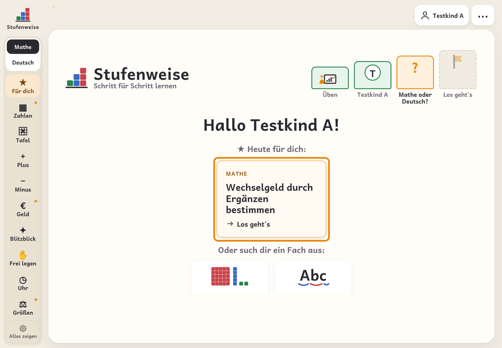

Die Übung stellt sich selbst ein, hier zum Beispiel Wechselgeld bis 20 €. Links sieht das Kind nur die Bereiche, die für es dran sind, mit ★ für die Förderzone. Bei Fehlern gibt es einen konkreten Tipp. Wie viel ein Kind sehen darf, stellst du in den Einstellungen unter „Geführte Oberfläche“ ein.

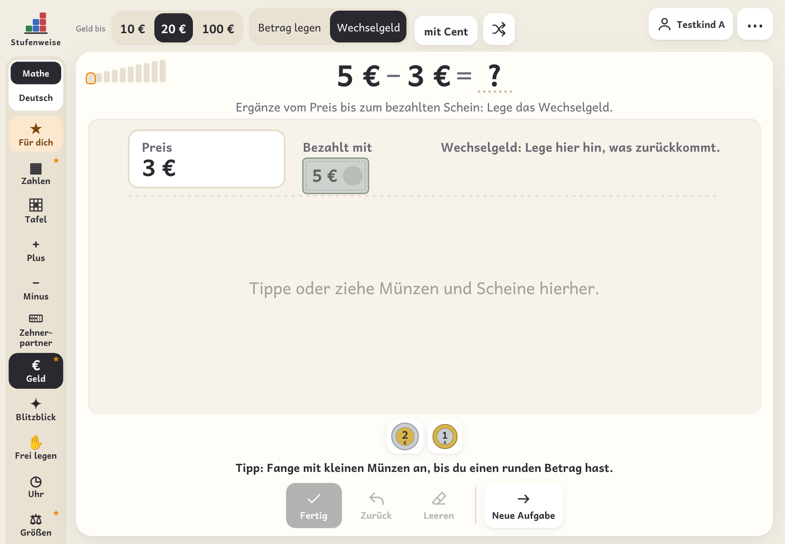

### Zehnerübergang als eigene Stufe

Bei Plus und Minus steigt die App in diesen Schritten auf (und bei vielen Fehlern wieder ab): bis 10 → bis 20 **ohne** Zehnerübergang → bis 20 **mit** Zehnerübergang → bis 100 ohne → bis 100 mit → bis 1000. Oben neben den Zahlen steht dann ein Hinweis wie „ohne Zehnerübergang“. Tippst du selbst auf einen Zahlenraum, ist das wieder aufgehoben. Hast du in den Einstellungen beim Zehnerübergang „mit“ oder „ohne“ festgelegt, gilt immer deine Einstellung.

### Zehnerpartner

Unter **Zehnerpartner** (in der Leiste links nach Minus) üben die Kinder die Zahlenpaare, die zusammen 10 ergeben, in der Grundschule oft „verliebte Zahlen“ genannt. Sie sind die Grundlage für den Zehnerübergang. Oben wählst du die Stufe:

- **mit Feld:** Im Zehnerfeld liegen Punkte. Wie viele fehlen bis 10?
- **im Kopf:** 7 + ☐ = 10, ☐ + 4 = 10, 10 − 6 = ☐ oder den passenden Partner antippen.
- **über 10:** schrittweise über die 10 rechnen, mit Zwanzigerfeld und Zerlegungsast wie auf dem Arbeitsblatt: Unter 8 + 5 zeigen zwei Striche von der 5 auf 8 + ☐ + ☐ = ☐ (erst bis 10, dann weiter). Auch mit Minus.

Die Zehnerpartner haben im Lernstand eine eigene Zeile (Z1–Z3). Im Mathe-Test (Teil 1) werden Z1 und Z2 geprüft, solange der Zehnerübergang bis 20 (R3) noch nicht sicher ist. Z3 („über die 10“) wird im Test nicht eigens abgefragt, sondern übernimmt das Ergebnis von R3 – so hängt die Einstufung nicht davon ab, ob ein Kind die Darstellung mit den Lücken versteht. Wer R3 schon kann, bekommt die Zehnerpartner als „abgeleitet erreicht“. Eine Förderzone bei den Zehnerpartnern führt in der Übung und bei den Arbeitsblättern direkt zur passenden Stufe. In der geführten Oberfläche sind sie sichtbar, wenn sie zur Förderzone gehören (vor dem ersten Test: solange Plus bis 10 oder bis 20 dran ist).

### Zwanzigerfeld beim Üben

Bei Plus und Minus bis 20 (und bis 10) gibt es unten die Ansicht **Zwanzigerfeld** (bis 10: Zehnerfeld). Die erste Zahl liegt schon als blaue Punkte im Feld. **Plus:** Das Kind legt die zweite Zahl in Orange dazu, indem es ins Feld tippt oder +1 und +5 nimmt. Wie üblich wird erst die obere Reihe voll gemacht. **Minus:** Das Kind streicht von hinten weg, mit Tippen oder −1 und −5. Dann schreibt es das Ergebnis oben in die Rechnung.

### Übungsrunden

Geübt wird in Runden zu 10 Aufgaben. Oben links zeigt eine kleine Treppe, wie weit das Kind in der Runde ist: grün heißt gleich richtig, gelb heißt nach einem zweiten Versuch richtig. Wer mit dem Pfeil zur nächsten Aufgabe springt, ohne die Aufgabe gelöst zu haben, verbraucht trotzdem eine Stufe: Sie wird gestreift (übersprungen) und zählt nicht als richtig. Auch ein Wechsel zwischen den Stufen oben (etwa von „Tausender“ zu „Finden“) beginnt keine neue Runde. So lassen sich schwere Aufgaben nicht wegklicken, und der Rückblick zeigt ehrlich, was gelöst wurde („… 1 übersprungen“). Nach der letzten Aufgabe kommt ein kurzer Rückblick („Geschafft! 10 Aufgaben – 8 davon gleich richtig“) mit großen Knöpfen:

- **Schwerer** (mit Angabe, was als Nächstes kommt), wenn mindestens 7 Aufgaben gleich richtig waren. Bei 9 oder 10 ist der Knopf hervorgehoben.
- **Leichter**, wenn weniger als die Hälfte gleich richtig war.
- **Noch eine Runde** und **Pause** (zurück zum Start).

Die App wechselt nie von selbst die Stufe; das Kind oder die Lehrkraft entscheidet. In der geführten Oberfläche geht „Schwerer“ nur bis zu den freigegebenen Stufen. Ist das Kind am Rand seiner Förderzone angekommen, bietet der Rückblick nach einer sehr guten Runde stattdessen „Nächste Stufe probieren“ an, einen Kurztest mit 2 bis 3 Aufgaben. Die Rundenlänge stellst du in den Einstellungen unter **Hilfen → Übungsrunde** ein (5, 10, 15 Aufgaben oder ohne Ende). Frei legen und Zahlen zeigen sind Werkzeuge und haben keine Runden.

Bei Lesetexten steht die Frage zwischen Text und Antworten, damit das Kind sie direkt vor dem Antworten liest.

### Frei legen mit Tausendern

Unter **Frei legen → Würfel** wählst du oben „Zehner und Einer“, „mit Hundertern“ oder „mit Tausendern“. Mit Tausendern kommen Tausenderwürfel dazu: 10 Hunderter lassen sich zu 1 Tausender bündeln und 1 Tausender wieder in 10 Hunderter tauschen. „Ordnen“ legt alles in die Stellenwerttafel T · H · Z · E.

### Wörter schreiben

Die Buchstabentastatur ist wie am Handy angeordnet (QWERTZ). Wer lieber nach dem ABC sucht, stellt das in den Einstellungen unter **Deutsch → Buchstabentastatur** um. Mit **⇧ groß** wird der nächste Buchstabe groß; das ß bleibt dabei ein ß, weil kein Wort mit ß anfängt.

Schreibt das Kind ein Wort fast richtig, markiert die App die einzelnen Buchstaben: grün stimmt, rot ist falsch, ein gestricheltes Kästchen zeigt einen fehlenden Buchstaben, durchgestrichen heißt zu viel. Stimmt mindestens die Hälfte, bleiben die grünen Buchstaben beim Verbessern stehen und das Kind füllt nur die roten Kästchen neu (aus „Prot“ wird _rot, das Kind tippt das B). Ist das Wort weit weg, gibt es keine Markierung, damit das Kind nicht rät, sondern neu ansetzt. Auf den Stufen „lautgetreu“ zählt ein Wort wie „Hunt“ schon als richtig; ab der Stufe Merkstellen wird es markiert.

### Hundertertafel und Tausenderbuch

Links unter **Tafel** übt das Kind mit der Hundertertafel (1 bis 100) in sieben Stufen: Zahlen finden, Tafel und Material verbinden (Zehnerstangen, Punktefeld, Zahlwort), Nachbarn und Lücken, Ausschnitte ergänzen, Wege gehen (unten +10, rechts +1), Muster erkennen und zuletzt das Tausenderbuch. Die Stufen H1–H7 sind Teil des Mathe-Tests (Teil 2) und erscheinen in der Kompetenzmatrix.

Bei **Zahlen**, **Plus** und **Minus** gibt es im Zahlenraum bis 100 außerdem die Ansicht **Tafel** (bis 1000: **Tausenderbuch**). Der Start ist orange markiert. Das Kind springt mit den Knöpfen +10 und +1 (bei Minus −10 und −1, bis 1000 auch ±100) oder tippt ein Feld in seiner Spalte (Zehner) oder ein paar Felder weiter (Einer) an. Schräge Sprünge lässt die App nicht zu. Der Weg bleibt sichtbar, darunter steht er als Rechnung, zum Beispiel „Start 52 · +10 +10 +10 +10 · 3-mal +1 = 95“. Bei jeder neuen Aufgabe beginnt der Weg neu.

Im Tausenderbuch zeigt links eine Seitenleiste alle zehn Seiten (1–100 bis 901–1000). Ein orangefarbener Punkt markiert die Startseite, ein blauer die Seite, auf der das Kind gerade ist. Mit einem Tipp auf eine Seite kann es blättern. Bei „Zahl suchen“ sind nur die erste Zeile und die Zehnerzahlen beschriftet; im Tausenderbuch muss das Kind zuerst die richtige Seite aufschlagen.

## Uhr auf die Minute genau

Auf der Stufe „Minuten genau“ übt die App normalerweise in 5-Minuten-Schritten. In den Einstellungen unter **Mathe → Uhr** kannst du auf **auf die Minute genau** umstellen. Dann kommen Uhrzeiten wie 6:37, und beim Uhr-Stellen gibt es Knöpfe für −5, −1, +1 und +5 Minuten. Der Test bleibt bei 5-Minuten-Schritten, damit die Ergebnisse vergleichbar sind.

Die Zeiger lassen sich auch mit dem Finger ziehen, beim Uhr-Stellen und im Unterricht an der Tafel: außen am Minutenzeiger die Minuten (über die 12 hinweg wandert die Stunde mit), innen am kurzen Zeiger die Stunde. Uhrzeiten in Worten folgen dem Alltag: „20 nach 2“, „4 vor halb 3“, „8 nach halb 3“, „20 vor 3“. Digitale Uhrzeiten kommen auch nachmittags und abends vor (z. B. 19:38 mit dem Hinweis „Es ist Abend“).

## Mehr Platz auf dem Bildschirm

Oben rechts stehen nur noch der Name und das Menü **⋯**. Im Menü findest du Lernstand, Arbeitsblätter, Rückmeldung, Anleitung, Vollbild und Einstellungen. Die Überschrift über der Aufgabe (z. B. „Hundertertafel · Tafel und Material verbinden“) fällt beim Üben weg, weil die Stufe schon oben in der Leiste markiert ist; so bekommt die Aufgabe mehr Höhe.

Ganz unten in der linken Leiste blendet **‹** die Leiste aus. Die Aufgabe bekommt dann die ganze Breite. Am linken Rand erscheint ein kleiner Knopf **›**, der die Leiste wieder einblendet. Die Einstellung bleibt auf dem Gerät gespeichert.

Beim Zahlenstrahl mit **Zahl suchen** bleibt die Übung an, wenn du den Zahlenraum wechselst; es kommt gleich eine neue Zahl im neuen Zahlenraum. **Mehr Zahlen** beschriftet jede Hauptmarke (bis 100 alle Zehnerzahlen, bis 1000 alle Hunderterzahlen) – eine Hilfe für Kinder, die sich am Strahl noch schwer orientieren.

## Unterricht an der Tafel

Beim Start fragt Stufenweise mit zwei Bildkacheln: **Üben** (mit Namen, Tests und Lernstand) oder **Unterricht** (an der Tafel zeigen). Im Unterricht gibt es keine Namen, keine Tests und keine Runden, und es wird nichts gespeichert. Auf großen Bildschirmen wie einer interaktiven Tafel ist alles etwas größer. Unten links in der Leiste führt **Üben** zurück; auf der Startseite tippst du dafür auf die erste Stufe „Üben“.

Die Werkzeuge:

- **Zahlen:** eine Zahl mit Material, am Zahlenstrahl oder in der Hundertertafel zeigen.
- **Zwanzigerfeld:** wie mit Wendeplättchen, als Zehnerfeld (bis 10) oder Zwanzigerfeld (bis 20). Gelegt wird wie üblich zeilenweise: erst die obere Reihe ganz, dann die untere. Mit **● Legen** (blau) die erste Zahl legen, mit **● Legen** (orange) die zweite – entweder ins Feld tippen (alle Plätze bis dorthin werden gefüllt) oder mit +1, +5, +10. **✕ Wegstreichen** streicht von hinten weg (Minus): ins Feld tippen oder −1, −5. Oben steht die passende Rechnung, zum Beispiel „8 + 5 = 13“ oder „13 − 5 = 8“. **Zahl vorgeben:** Oben eine Zahl eingeben und **Legen** tippen (oder Enter): Das Feld wird neu mit dieser Anzahl gefüllt, ganz ohne Rechnung – zum Beispiel 14, damit die Kinder die Menge erkennen und benennen. **Zufallszahl** lost eine Zahl aus. **Zahl verdecken** zeigt statt der Zahl ein „?“ (bei einer Rechnung statt des Ergebnisses „= ?“); antippen deckt auf, die aufgedeckte Zahl noch einmal antippen deckt wieder zu. Einen gelegten Punkt antippen nimmt ihn und alle danach wieder weg, **Zurück** nimmt den letzten Schritt zurück.
- **Zahlenstrahl:** bis 10, 20, 100 oder 1000. Erst eine Stelle antippen: Dort beginnt der Weg (orange). Dann mit den Knöpfen springen (+1, +10, −10 …) oder eine andere Stelle antippen. Die Bögen haben die Stellenwertfarben, oben steht die Rechnung. **Rechenstrich** blendet die Striche aus (leerer Zahlenstrahl). **Ziel verdecken** zeigt am Ende ein „?“; antippen deckt das Ergebnis auf. **Zusammenfassen** (eingeschaltet) addiert gleiche Sprünge mit den Knöpfen gleich: +10 und nochmal +10 wird ein Bogen +20, +1 und nochmal +1 wird +2. Zehner und Einer bleiben getrennt, so bleibt der Weg „erst Zehner, dann Einer“ sichtbar (z. B. 47 + 20 + 3 = 70). Angetippte Sprünge werden nicht zusammengefasst. **Zurück** nimmt immer nur den letzten Tipper zurück (aus +3 wird +2). Ist Zusammenfassen ausgeschaltet, bleibt jeder Sprung einzeln stehen: Viele gleiche kleine Sprünge werden dann schmaler gezeichnet und gemeinsam beschriftet („13-mal +1“), und nach zehn gleichen Einer- oder Zehnersprüngen erscheint der Knopf **„10-mal +1 ist +10 · zusammenfassen“** – so lässt sich der Schritt vom Zählen zum geschickten Springen gemeinsam zeigen. Mit **+** und **−** oben rechts (oder zwei Fingern) vergrößerst du einen Ausschnitt, mit einem Finger verschiebst du ihn, **↔** zeigt wieder den ganzen Strahl. Vergrößert lassen sich auch im Tausenderraum einzelne Einer genau antippen.
- **Hundertertafel:** Felder färben (vier Farben, auch ganze 2er-, 5er- oder 10er-Reihen) oder abdecken. „Alles abdecken“ macht eine leere Tafel, die du Feld für Feld aufdeckst.
- **Frei legen** und **Blitzblick** wie beim Üben.
- **Uhr:** Zeiger mit + und − stellen (in Schritten von 1, 5 oder 15 Minuten), dazu auf Wunsch die Digitalzeit und die Uhrzeit in Worten.
- **Wörter:** ein Wort oder einen Satz eintippen und groß zeigen, mit farbigen Silben und Silbenbögen. Kennt die App ein Bild zum Wort, erscheint es dazu.

In den Einstellungen unter **Allgemein → Beim Start** kannst du festlegen, dass ein Gerät immer direkt mit Üben oder immer mit Unterricht startet, zum Beispiel der Rechner an der Tafel.

## Schritt 6: Arbeitsblätter drucken

1. Oben auf **Arbeitsblätter** (3) tippen.
2. Das Kind wählen. Unter „Passend zur Förderzone“ stehen seine Stufen, zum Beispiel „Rechnen R3“.
3. Das Blatt wählst du in drei Schritten: **Fach** (Basis, Mathe, Deutsch), dann **Bereich** (zum Beispiel bei Mathe: Zahlen, Rechnen, Hundertertafel, Uhr, Größen und Geld, Legeblätter), dann **Blatt** aus einer kurzen Liste. Wechselst du zurück in ein Fach, ist das dort zuletzt gewählte Blatt wieder da. Unter „Zuletzt benutzt“ stehen die Blätter, die du zuletzt gedruckt, gespeichert oder ins Heft übernommen hast. Wählst du ein Kind mit Förderzone, stellt sich das passende Fach ein. Dann bei Bedarf Zahlenraum und Material anpassen. Bei „Aufgaben“ füllt „Blatt füllen“ die Seite mit vollen Reihen; du kannst auch eine feste Zahl wählen. Rechts siehst du die Vorschau.
4. **Drucken** tippen. „Lösungsblatt anhängen“ legt eine Seite mit den Lösungen dazu.

**Materialbilder:** Bei Plus, Minus, Ergänzen, Einmaleins, Zehnerpartnern und „Rechnen über die 10“ wählst du „bei allen Aufgaben“, „1. Aufgabe vorgegeben, dann selbst zeichnen“ oder „ohne“. Beim Zeichnen zeigt die erste Aufgabe das Bild als Beispiel, bei Zahlen ab 20 in der Kurzschreibweise (| Zehner, • Einer). Die weiteren Aufgaben haben ein leeres Zwanzigerfeld (bei Plus und Minus immer mit 20 Feldern, auch bis 10) oder ein Zeichenfeld.

**Geld zählen:** Wähle „nur Euro“, „Euro und Cent“ (10-, 20- und 50-Cent-Münzen) oder „auf den Cent“ (auch 1, 2 und 5 Cent), wie beim Üben.

**Einmaleins:** Unter „Reihen“ kreuzt du an, welche Reihen auf dem Blatt vorkommen. Die Auswahl steht auch in der Überschrift, zum Beispiel „Einmaleins: 3er- und 7er-Reihe“.

**Zehnerpartner und Rechnen über die 10:** Zwei Blätter zum Zehnerübergang. „Zehnerpartner“ hat Aufgaben am Zehnerfeld (4 + ☐ = 10), ohne Bild (☐ + 9 = 10, 10 = 7 + ☐, 10 − 8 = ☐) und zum Verbinden der Partner. „Rechnen über die 10“ zeigt den Rechenweg mit einem Zerlegungsast: 7 + 8 = ☐, darunter 7 + ☐ + ☐ = ☐. Die erste Plus- und die erste Minus-Aufgabe sind als Beispiel grau ausgefüllt. Unter „Rechenart“ wählst du Plus, Minus oder gemischt. Bei Minus wählst du unter „Minus im Bild“, ob das Wegstreichen im Zwanzigerfeld schon eingezeichnet ist oder ob nur die Ausgangsmenge zu sehen ist und die Kinder selbst streichen („Streiche 5 weg.“). Dieselbe Auswahl gibt es beim Blatt Minus bis 20. Bei den Förderzonen R1 bis R3 stehen beide Blätter auch unter „Passend zur Förderzone“.

**Einstellungen bleiben:** Thema, Zahlenraum, große Aufgaben, Materialbilder und die anderen Einstellungen merkt sich das Gerät bis zum nächsten Mal. Das Kind wählst du jedes Mal neu.

**Große Aufgaben:** Mit dem Häkchen „Große Aufgaben“ werden Zahlen, Schreibkästchen und Bilder etwa ein Drittel größer, dafür passen weniger Aufgaben auf das Blatt. Das hilft Kindern, die mehr Platz zum Schreiben, Streichen und Zeigen brauchen. Die Einstellung gilt auch, wenn du das Blatt ins Arbeitsheft übernimmst.

**Minus mit Zehnerübergang:** Beim Wegstreichen bis 100 oder 1000 streichen die Kinder normalerweise Kästchen im Zehner weg, der Zehner wird also „angebrochen“. Mit „Zehnerübergang: Umtausch schon im Bild zeigen“ ist der nötige Umtausch schon gemacht: Ein Zehner liegt als 10 Einer da (bis 1000 bei Bedarf auch ein Hunderter als 10 Zehner), gestrichelt umrandet und unter dem Bild benannt, zum Beispiel „1 Zehner = 10 Einer“. Das ist eine Stütze für Kinder, die den Umtausch mit echtem Material kennen, ihn im Bild aber noch nicht selbst herstellen. Den Umtausch selbst üben die Kinder vorher am Material.

**Kopf- und Fußzeilen:** Am Computer werden Arbeitsblätter, Legeblätter und das Arbeitsheft ohne Datum und Internetadresse am Rand gedruckt. Stehen sie trotzdem auf dem Blatt, im Druckdialog „Kopf- und Fußzeilen“ ausschalten. Auf dem iPad und iPhone hängt Safari immer eine Fußzeile an; das lässt sich dort nicht abschalten. Für saubere Blätter am Computer drucken.

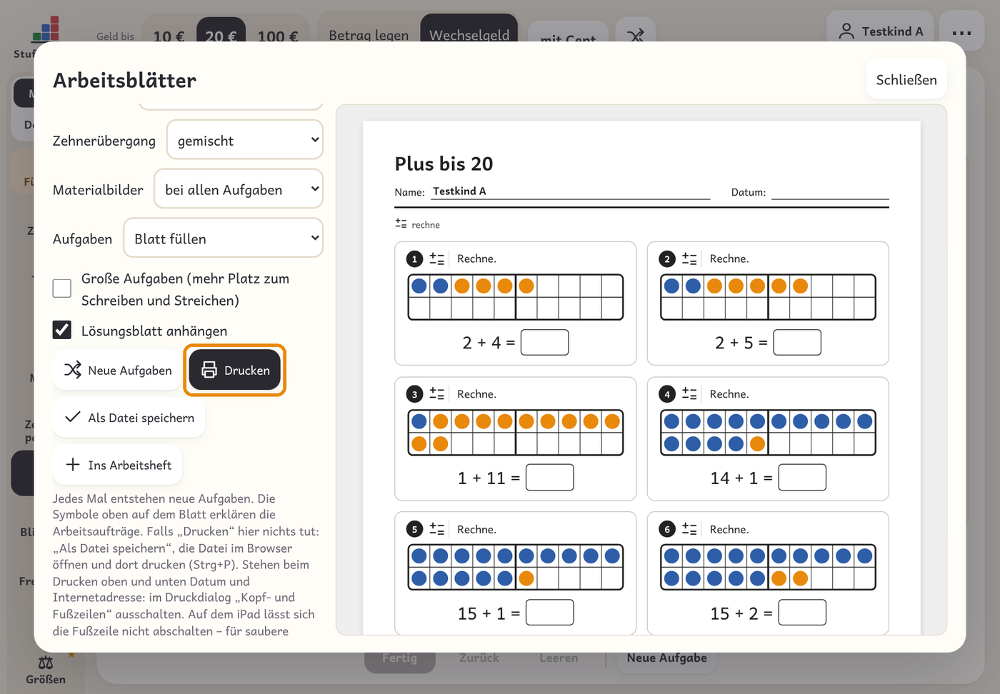

Unter „Hundertertafel und Tausenderbuch“ gibt es Blätter zu allen sieben Stufen und drei Material-Blätter: eine ausgefüllte Hundertertafel, eine leere Tafel zum Eintragen und das Tausenderbuch: Unter „Seite“ wählst du eine bestimmte Seite (zum Beispiel 701–800) oder „ganzes Tausenderbuch“. Dann kommen alle 10 Seiten von 1–100 bis 901–1000 zum Ausdrucken und Binden; mit „Ins Arbeitsheft“ werden es 10 Heftseiten.

Jedes Mal entstehen neue Aufgaben. Jedes Blatt trägt unten den Hinweis „Stufenweise · © Stefan Hackl · frei nutzbar unter CC BY-SA 4.0“, du darfst es also kopieren und weitergeben.

Alle Materialbilder auf einem Blatt haben dieselbe Größe, Hunderter liegen in Fünferreihen. Neu ist das Thema **Zahlen mit Material zeichnen**: Die Kinder zeichnen Zahlen in der Kurzschreibweise □ Hunderter, | Zehner, • Einer und lesen gezeichnete Zahlen ab. Wählst du eine Förderzone aus dem Rechnen, passt das Blatt genau dazu, zum Beispiel „Plus bis 20, mit Zehnerübergang“ für R3.

### Basis: Grundlagen vor dem Zählen

**Üben in der App:** Oben in der Fachwahl steht **Basis** an erster Stelle, vor Mathe und Deutsch. Links wählst du die Stufe: unter „Vergleichen“ Gleiches, passt nicht, Sortieren, Zuordnen, Mengen, Größe, Muster, Blick; unter „Orientieren“ Formen, Richtung, Reihe.

Die Aufgaben sind klar geteilt: **Oben hellblau** liegt die Vorgabe oder das Ziel (das Bild zum Vergleichen, die Kisten, die Plätze). **Unten beige** liegt der Vorrat. Die Kinder legen Dinge aus dem Vorrat dazu: Sie **schieben** ein Ding mit dem Finger an seinen Platz, oder sie tippen es an und dann den Platz.

- **Bild wählen:** das gleiche Bild, was nicht passt, wo mehr sind, das größte, was als Nächstes kommt. Bei „Tippe alle … an“ können es mehrere sein.
- **Sortieren:** jedes Ding in die richtige Kiste schieben. Ein Ding zurück in den Vorrat schieben (oder antippen) nimmt es wieder heraus.
- **Dazulegen:** das gleiche Bild oder einen Löffel unter jede Tasse legen. Bei „Jedem eins“ liegen mehr Dinge im Vorrat als nötig, und unter eine Tasse passen auch zwei: Richtig ist es erst, wenn unter jeder Tasse genau eins liegt. So kann man sich wirklich vertun. Bei „Reicht es?“ sieht man, ob ein Platz leer bleibt oder etwas übrig ist, und wählt „ja“ oder „nein“.
- **Der Reihe nach legen:** von klein nach groß oder die Bildfolge auf die Plätze 1, 2, 3 legen. Bei „Von links nach rechts“ tippen die Kinder die Bilder der Reihe nach an.
- **Auf einen Blick:** Das Bild ist kurz zu sehen und wird dann abgedeckt. „Nochmal zeigen“ zeigt es noch einmal.

Nach „Prüfen“ wird Falsches rot markiert. Jede Stufe hat ein festes Bildsymbol vor dem Auftrag.

**Eine Aufgabenart nach der anderen:** Innerhalb einer Stufe gibt es mehrere Aufgabenarten, von leicht nach schwer (bei „Gleiches“ zum Beispiel: Gleiches Bild, Gleiches dazulegen, Gleiche Farbe, Farbe dazulegen; bei „Sortieren“: Nach Farbe, Nach Größe, Nach Art, Farbe bei verschiedenen Dingen). Das Kind bleibt bei einer Aufgabenart und wiederholt sie. Am Anfang sind es nur 2 oder 3 Bilder, nach einigen richtigen Aufgaben werden es mehr. Wer dreimal hintereinander danebenliegt, bekommt wieder leichtere Aufgaben. Nach 8 Aufgaben, die beim ersten Versuch richtig waren, erscheint „Nächste Aufgabe“ für die nächste Aufgabenart. Oben in der Leiste kannst du jede Aufgabenart auch direkt wählen.

**Schwerer durch Ähnlichkeit:** Bei Gleiches finden, Was passt nicht? und Sortieren steigt die Schwierigkeit in zwei Richtungen, mit denselben Dingen: mehr Bilder und ähnlichere Dinge. Erst sind die Dinge **deutlich** verschieden (Hammer, Schraube, Mutter – und eine Gabel), dann **ähnlich** (lauter Werkzeuge: Hammer, Schraubenzieher, Schraubenschlüssel – und eine Gabel), zuletzt **fein** (verschiedene Hämmer, Schraubenzieher und Schlüssel – und eine Schraube, die kein Werkzeug ist). Beim Sortieren heißt das: erst Küche und Werkstatt, dann Besteck und Geschirr (oder Werkzeug und Schrauben, Nägel), zuletzt alle Löffel und alle Gabeln. Bei „Nach Größe“ werden die Größenunterschiede kleiner. Diese Aufgabenarten haben sechs Schritte (deutlich, ähnlich, fein – jeweils erst mit wenigen, dann mit mehr Bildern); „Nächste Aufgabe“ erscheint deshalb erst nach 12 richtigen. Auf den Arbeitsblättern zu V1–V3 wählst du die Ähnlichkeit unter **Ähnlichkeit** (deutlich, ähnlich, fein). Im Basis-Test bleibt die leichte Form bei „deutlich“.

**Vormachen:** Bevor ein Kind eine Aufgabenart zum ersten Mal bekommt, macht Stufenweise sie einmal vor. Dann ist die ganze Aufgabe orange umrandet, oben steht groß „Schau zu“ mit einem Auge, und eine Hand zeigt, was angetippt und wohin geschoben wird. Das Kind kann dabei nichts antippen; auch „Jetzt du“ ist erst nach dem Vormachen frei. Mit „Jetzt du“ verschwindet der Rahmen, kurz erscheint grün „Jetzt du“, und das Kind ist dran. „Vormachen“ unten zeigt das Beispiel jederzeit noch einmal. Erkläre den Auftrag dazu mit eigenen Worten.

**Wer Basis sieht:** Ohne gewähltes Kind (Gast) und in der Lehrkraft-Ansicht immer. Ein Kind sieht „Basis“, wenn du im Fenster **„Wer übt?“** neben „ohne Lesen“ das Häkchen **Basis** setzt (oder unter **Einstellungen → Kinder & Daten → Basis**), oder automatisch, sobald der Basis-Test eine Förderzone zeigt. So werden Kinder, die schon zählen und lesen, nicht damit gelangweilt. Unter „Heute für dich“ steht Basis dann an erster Stelle.

**Basis-Test:** Unter **Testen** auf der Startseite und im Lernstand des Kindes unter „Basis“ gibt es drei kurze Teile, damit es für die Kinder nicht zu lang wird: **Teil 1** Gleiches, passt nicht, Sortieren, Zuordnen (V1–V4), **Teil 2** Mengen, Größe, Muster, auf einen Blick (V5–V8), **Teil 3** Formen, Richtung, von links nach rechts (O2–O4). Die Teile kann man an verschiedenen Tagen machen; jeder Teil hat etwa 12 bis 16 Aufgaben. Erkläre den Auftrag jeweils mit eigenen Worten.

So läuft eine Stufe ab: Zuerst kommt die **leichte Form**. Stufenweise macht sie einmal vor (orange umrandet, „Schau zu“, nichts antippbar; das zählt nicht). Mit „Jetzt du“ folgen zwei oder drei Aufgaben derselben Art, erst mit wenigen, dann mit mehr Bildern. Nur wenn die leichte Form klappt (2 von 2 oder 2 von 3), kommt die **schwerere Form**: wieder erst vormachen, wenn es eine andere Aufgabenart ist, dann zwei oder drei Aufgaben. Das Ergebnis: beide Formen gelöst = **erreicht**, nur die leichte = **teilweise**, die leichte noch nicht = **nicht erreicht**. Bricht ein Kind ab, bleibt das bis dahin Getestete gespeichert.

| Stufe | leichte Form | schwerere Form |
| --- | --- | --- |
| V1 Gleiches finden | gleiches Bild | gleiches Bild, gleiche Farbe |
| V2 Was passt nicht? | eins ist ganz anders | nur die Farbe ist anders |
| V3 Sortieren | gleiche Dinge nach Farbe | verschiedene Dinge nach Farbe |
| V4 Eins zu eins | unter jede Tasse genau einen Löffel (es bleibt etwas übrig) | „Reicht es?“ |
| V5 Mengen | Wo sind mehr? | mehr oder gleich viele? |
| V6 Größe | 3 Dinge ordnen | 4 Dinge ordnen |
| V7 Muster | AB | AAB, ABB, ABC |
| V8 Auf einen Blick | 1–3 Punkte | 1–4 Punkte, andere Anordnung |
| O2 Formen | Form finden | Quadrat oder Rechteck |
| O3 Richtung | gleicher Pfeil | Zeichen anders herum |
| O4 Von links nach rechts | der Reihe nach antippen | Bildfolge ordnen |

**Auswertung:** Die Kompetenzmatrix hat zwei Zeilen, „Vergleichen und Ordnen“ und „Sehen und Orientieren“. Es sind **Bereiche, keine Treppe**: Jeder Bereich wird für sich eingeschätzt, nichts wird aus einem anderen abgeleitet. Die Förderzone (höchstens zwei Bereiche) folgt der empfohlenen Reihenfolge V1 → V2 → O2 → V3 → V4 → V5 → V7 → O4 → V6 → O3 → V8. Dazu gibt es Begründung, Weg am Material, Arbeitsblatt, ILEB-Vorschlag und Ideen für zu Hause in der Elterninfo. Lage im Raum (O1) und Sich etwas merken (O5) kommen später dazu.

**Hinweis im Lernstand:** Ist im Mathe-Test „Zahlen bis 10, Stufe I“ oder im Lese-Test „L1 Schilder und Bilder“ nicht erreicht, schlägt der Lernstand den Basis-Test vor. Der Mathe- und der Lese-Test werden dadurch nicht länger.

**Arbeitsblätter:** Unter Fach „Basis“, Bereiche „Vergleichen“ und „Orientieren“, stehen Blätter für Kinder, die noch nicht sicher zählen: Gleiches finden (V1), Was passt nicht? (V2), Sortieren (V3), Eins zu eins zuordnen (V4), Mehr, weniger, gleich viel (V5), Der Größe nach ordnen (V6), Muster fortsetzen (V7), Formen unterscheiden (O2), Richtung und Spiegelung (O3) und Von links nach rechts (O4). Die Blätter kommen ohne Zahlen und fast ohne Lesen aus: Die Kinder verbinden, kreisen ein, streichen durch und malen weiter.

**Erklären statt lesen:** Die erste Aufgabe jeder Art ist grau gestrichelt vorgemacht. Lies den Auftrag vor und zeige ihn an dieser Aufgabe; die nächste Aufgabe derselben Art machen die Kinder selbst. Auf dem Lösungsblatt steht zu jeder Aufgabe, welches Bild gemeint ist (zum Beispiel „2. Bild (Gabel)“).

**Schwarz-Weiß-Drucker:** Mit dem Häkchen „Schwarz-Weiß-Drucker (Muster statt Farben)“ bekommen die Farben Muster (Streifen, Punkte, Karos). So lassen sich auch Farb-Aufgaben schwarz-weiß kopieren; der Auftrag heißt dann „gleiches Muster“ statt „gleiche Farbe“.

### Legeblätter für echtes Material

Die **Legeblätter für echtes Material** stehen bei jedem Fach als eigener Bereich „Legeblätter“. Auf diese Blätter legen die Kinder Wendeplättchen, Einerwürfel, Zehnerstangen oder Buchstabenkarten, bevor sie rechnen oder schreiben:

- **Mathe:** Zehnerfeld, Zwanzigerfeld (Querformat), Zahlenstrahl bis 20, Zahlenstrahl bis 100 oder 1000, Hunderterfeld in 1 cm für Einerwürfel, Stellentafel (bis 100 hochkant, bis 1000 quer, breit genug für Hunderterplatten und Zehnerstangen), Preise mit Spielgeld legen, Zifferblatt mit Zeigern zum Ausschneiden, Zifferblatt mit Minutenkranz.
- **Basis:** Sortierunterlage mit zwei Feldern (Küche und Werkstatt, zwei Farben oder ohne Bild zum Selbstbeschriften), Zuordnungsleiste „eins zu eins“ (unter jedes Bild ein echtes Ding legen) und Musterstreifen für Plättchen (AB, AAB/ABB, ABC oder leer zum Vorlegen).
- **Deutsch:** Anfangsbuchstaben legen, Wörter legen (ein Kästchen pro Buchstabe), Wörter nachlegen mit Vorlage, Merkwörter nachlegen (Merkstelle farbig), Silben legen (ein Stein pro Silbe), Buchstabenkarten zum Ausschneiden (groß und klein, häufige Buchstaben öfter; ein Strich zeigt, wo unten ist).

Bei den meisten Mathe-Blättern wählst du unter **Aufgaben**, was dazu auf dem Blatt steht, zum Beispiel „Plus“, „Ergänzen bis 20“ oder „ohne Aufgaben“ für das freie Legen. **Wichtig:** in Originalgröße drucken (100 %, nicht „An Seite anpassen“). Unten auf jedem Legeblatt ist ein 5-cm-Strich: Ist er kürzer, wurde verkleinert. Im Lernstand öffnet **Legeblatt drucken** direkt das passende Blatt zur Förderzone. Legeblätter lassen sich auch ins Arbeitsheft übernehmen.

### Arbeitsheft

Mehrere Blätter lassen sich zu einem Heft zusammenstellen:

1. Ein Blatt einstellen und auf **Ins Arbeitsheft** tippen. Das Blatt wird genau so übernommen, wie es in der Vorschau steht. Für jede weitere Seite wiederholen.
2. Oben auf **Arbeitsheft** wechseln. Dort Titel und Namen für das Titelblatt wählen (oder leer lassen zum Selbstschreiben), die Reihenfolge mit ↑ ↓ ändern oder Seiten entfernen.
3. **Heft drucken.** Das Heft hat ein Titelblatt mit Namen und Inhaltsverzeichnis. Die Seiten haben Seitenzahlen, aber keine Namenszeilen und keine Lösungen.

Das Heft bleibt auf dem Gerät gespeichert, bis du es leerst.

**Heft zur Förderzone:** Wenn ein Kind schon getestet wurde, kann Stufenweise das Heft selbst zusammenstellen. Im Lernstand des Kindes auf **Arbeitsheft zur Förderzone** tippen (oder im Arbeitsheft oben das Kind wählen). Die App zeigt die Förderzonen in Mathe, Lesen und Schreiben. Wähle 1 oder 2 Blätter je Stufe und tippe auf **Heft erstellen**. Jedes Blatt wird mit neuen Aufgaben gefüllt. Ein vorhandenes Heft wird dabei ersetzt; danach kannst du wie gewohnt Seiten verschieben, entfernen oder weitere hinzufügen.

## Schritt 7: Rückmeldung geben

Melde dich am besten genau dann, wenn dir etwas auffällt. Die App schickt automatisch mit, wo du gerade bist, aber keinen Kindernamen.

1. Oben auf **Rückmeldung** (4) tippen.
2. Auswählen: **Fehler**, **Passt nicht**, **Idee** oder **Gefällt mir**.
3. Bei Fehlern und „Passt nicht“ angeben, wie schlimm es ist.
4. In eigenen Worten schreiben, was passiert ist und was du erwartet hättest.
5. **Auf GitHub melden** tippen: Das öffnet eine fertig ausgefüllte Meldung (Issue), du musst sie nur noch absenden. Dafür brauchst du ein kostenloses GitHub-Konto. Die Meldung ist öffentlich, also bitte keine Namen von Kindern.
    - Optional **Per E-Mail senden:** Diesen Knopf gibt es nur, wenn in den Einstellungen eine Adresse eingetragen ist, zum Beispiel die der Testleitung an deiner Schule. Die Adresse bleibt nur auf deinem Gerät.

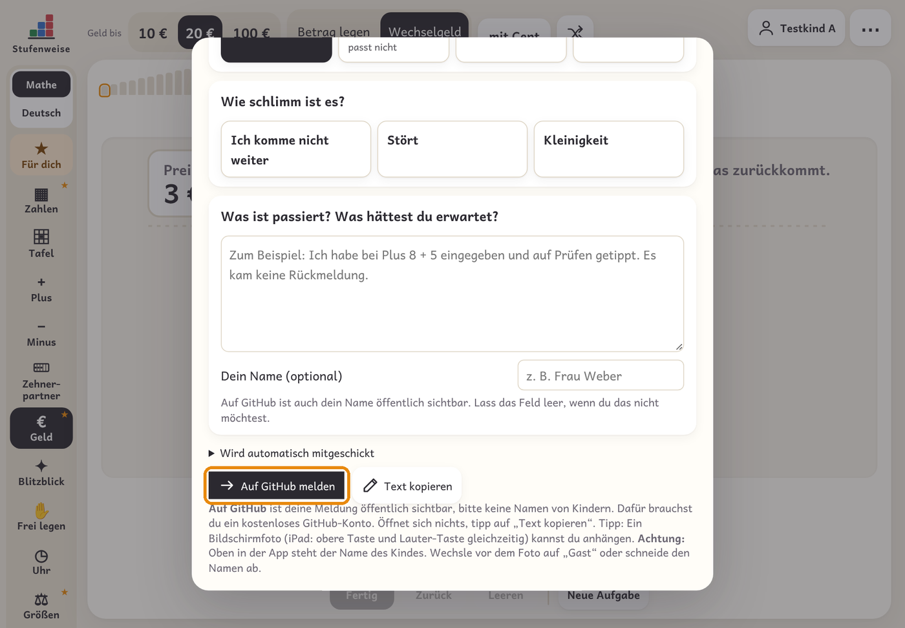

Öffnet sich nichts, tipp auf **Text kopieren** und füge den Text in eine [neue Meldung auf GitHub](https://github.com/Steffinuss/stufenweise/issues/new) ein.

## Auf dem iPad: als App auf den Home-Bildschirm und aktualisieren

In Safari auf „Teilen“ → „Zum Home-Bildschirm“ tippen. Stufenweise startet dann wie eine App, ohne Adressleiste.

iPadOS lädt eine solche App beim Öffnen oft nicht neu. Deshalb prüft Stufenweise selbst, ob es eine neue Version gibt: beim Öffnen, beim Zurückkehren in die App und alle 30 Minuten. Gibt es eine, erscheint oben der Hinweis „Neue Version … ist da“ mit dem Knopf **Jetzt aktualisieren**, aber nur auf dem Startbildschirm (Auswahl Üben/Unterricht, Namensauswahl, Werkzeugwahl an der Tafel). Während ein Kind übt, bleibt der Hinweis weg, damit niemand mitten in der Übung die App neu startet. Von Hand geht es in den Einstellungen („Nach neuer Version suchen“) oder in der Anleitung neben der Versionsnummer („Aktualisieren“). Namen, Ergebnisse und Einstellungen bleiben dabei erhalten.

**Ohne Internet:** Wurde Stufenweise einmal mit Internet geöffnet, startet es danach auch ohne WLAN (mit der zuletzt geladenen Version). Sobald wieder Internet da ist, kommt die neueste Version wie gewohnt.

### Daten sichern

Alle Namen und Ergebnisse liegen nur auf diesem Gerät, und zwar getrennt für jede Adresse und für die App auf dem Home-Bildschirm. Wer das Symbol vom Home-Bildschirm löscht oder in Safari die Websitedaten löscht, löscht auch die Ergebnisse. Deshalb: Einstellungen → „Daten sichern“ → **Sicherung speichern**. Die Datei landet in der Dateien-App und kann mit „Sicherung laden“ zurückgeholt oder auf ein anderes Gerät gebracht werden. Ist die letzte Sicherung 14 Tage oder länger her, erinnert der Lernstand mit einem Hinweis „Jetzt sichern“. Die App bittet das iPad außerdem, ihre Daten dauerhaft aufzubewahren.

### Geräteumzug per QR-Code

So kommen Kinder ohne Datei und ohne Internet auf ein anderes Gerät, zum Beispiel vom Lehrer-iPad auf ein Schüler-iPad:

1. Auf dem **alten Gerät**: Einstellungen → Kinder & Daten → **Per QR-Code senden**. Kinder ankreuzen (auf Wunsch auch die Einstellungen, die PIN wird nie übertragen) und **QR-Codes zeigen** tippen.
2. Auf dem **neuen Gerät**: Einstellungen → Kinder & Daten → **Per QR-Code empfangen**. Beim ersten Mal fragt das iPad, ob Stufenweise die Kamera benutzen darf: erlauben.
3. Die Kamera des neuen Geräts auf den Bildschirm des alten halten. Bei vielen Daten wechseln die QR-Codes von selbst; die Reihenfolge ist egal, kleine Kästchen zeigen, welche Teile schon angekommen sind. Meist dauert das zehn bis zwanzig Sekunden.
4. Zum Schluss zeigt das neue Gerät, welche Kinder angekommen sind. **Übernehmen** tippen.

Ist ein Kind auf beiden Geräten schon da, wird zusammengeführt: Die Übungen beider Geräte bleiben erhalten, bei Name, Bild und Lernstand gilt der neuere Stand. Bei sehr vielen Übungen werden per QR-Code nur die neuesten übertragen (die App sagt dann, wie viele); den ganzen Verlauf bringt die Sicherungsdatei mit.

Tipps: Den Bildschirm des alten Geräts hell stellen, die Kamera etwa 20 bis 30 Zentimeter davor halten und Spiegelungen vermeiden. Die QR-Codes enthalten Namen und Lernstände: nur zwischen Schulgeräten im selben Raum verwenden und nicht fotografieren.

## Am Handy ausprobieren

Stufenweise ist für Tablet und Computer gemacht. Zum schnellen Ausprobieren geht auch ein Handy, **hochkant gehalten**:

- Die Startseite zeigt *Üben* und *Unterricht* nebeneinander.
- Die Leiste mit den Bereichen liegt oben und lässt sich zur Seite wischen.
- Passt eine Aufgabe nicht ganz auf den Bildschirm, scrollt die Seite nach unten.
- Die Zifferntastatur sitzt unten über die ganze Breite. Mit ▾ rollst du sie ein.

Quer gehalten ist zu wenig Platz; dann bittet die App, das Handy zu drehen. Für den Unterricht mit Kindern bleibt das iPad die bessere Wahl: Die Hundertertafel und kleines Material sind am Handy zum Antippen sehr klein.

## Über Stufenweise: Lizenz und Danke

Stufenweise ist ein offenes Projekt: kostenlos, ohne Werbung und für alle Schulen. Unter **Anleitung (?)** steht ganz unten „Über Stufenweise“.

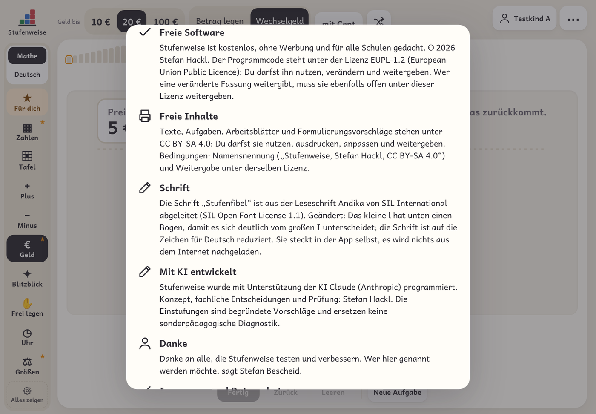

| Was | Lizenz | Das bedeutet |
| --- | --- | --- |
| Programmcode | [EUPL-1.2](../LICENSE) | Nutzen, verändern und weitergeben erlaubt. Wer eine veränderte Fassung weitergibt, muss sie ebenfalls offen unter EUPL-1.2 weitergeben. |
| Texte, Aufgaben, Arbeitsblätter, diese Anleitung | [CC BY-SA 4.0](../LIZENZ-INHALTE.md) | Nutzen, ausdrucken, anpassen und weitergeben erlaubt, mit Namensnennung „Stufenweise, Stefan Hackl, CC BY-SA 4.0“ und unter derselben Lizenz. |

Stufenweise wurde mit Unterstützung der KI Claude (Anthropic) programmiert. Konzept, fachliche Entscheidungen und Prüfung liegen bei Stefan Hackl.

---

Diese Anleitung steht unter [CC BY-SA 4.0](https://creativecommons.org/licenses/by-sa/4.0/deed.de) · Stufenweise, Stefan Hackl
